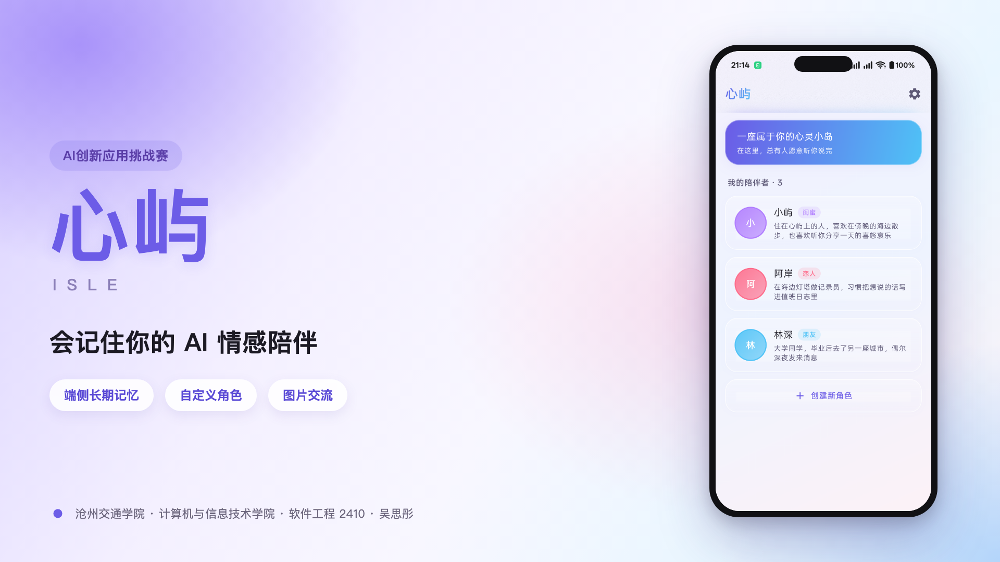
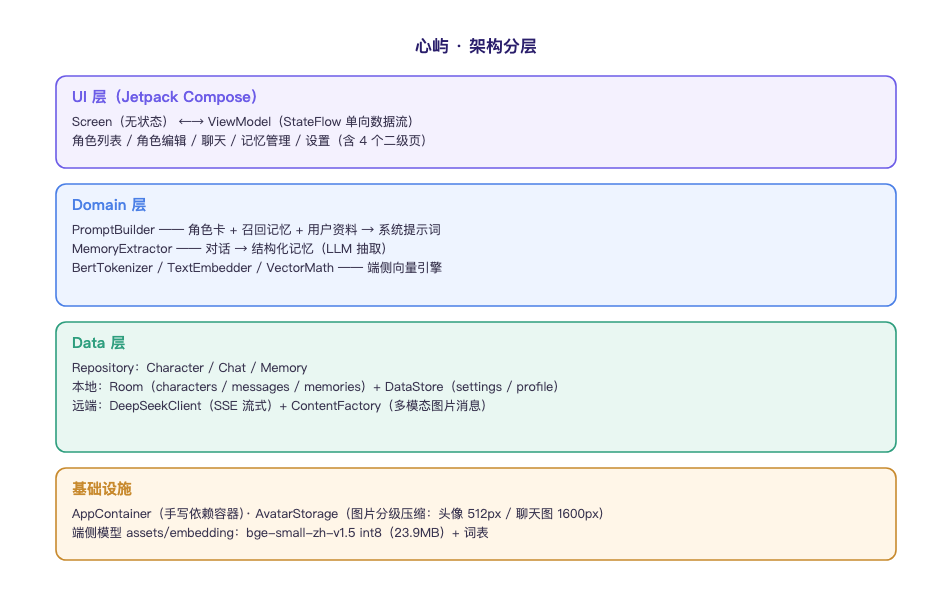
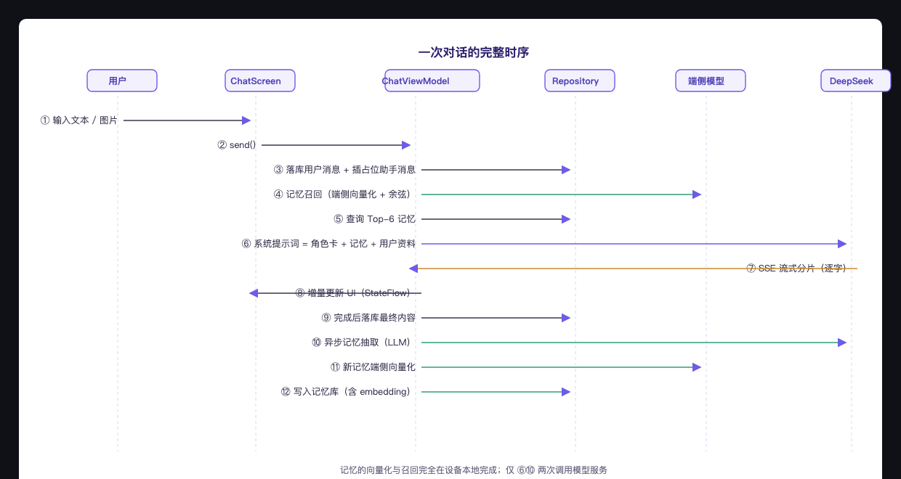
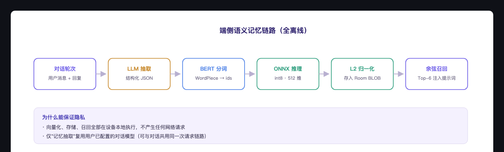

# 心屿（Isle）

> **一款会记住你的 AI 情感陪伴应用**
>
> 一款会记住你的 AI 情感陪伴应用
> 沧州交通学院 · 计算机与信息技术学院 · 软件工程 2410 · 吴思彤



---

## 这是什么

心屿是一款原生 Android **AI 情感陪伴**应用。

你可以创建专属的陪伴角色——恋人、闺蜜、朋友或家人，为 TA 设定性格、背景与说话方式，
上传 TA 的模样。TA 会记得你说过的话、喜欢的东西、在意的事，在每一次聊天里带着对你的了解出现，
像一位认识很久的朋友，而不是每次都要重新认识的陌生人。

**技术上的核心差异：长期记忆与向量检索完全在手机本地；发送消息时，对话内容会传输至你配置的模型服务。**

---

## 核心能力

<table>
<tr>
<td width="33%"></td>
<td width="33%"></td>
<td width="33%"></td>
</tr>
<tr>
<td align="center"><b>角色列表</b><br/>内置角色 + 自由创建</td>
<td align="center"><b>流式对话</b><br/>逐字回复 · 支持图片</td>
<td align="center"><b>长期记忆</b><br/>角色自主积累 · 可管理</td>
</tr>
</table>

### 1. 自定义角色

| 能力 | 说明 |
| --- | --- |
| 六个可定义维度 | 名称 / 关系类型 / 性格 / 背景故事 / 说话风格 / 开场白 |
| 头像上传 | 支持相册选择与相机拍摄，自动压缩存入应用内部目录 |
| 多角色管理 | 内置默认角色，支持创建、编辑、删除（删除时级联清除其会话与记忆） |


### 2. 长期记忆（核心差异化）

| 能力 | 说明 |
| --- | --- |
| 自动抽取 | 每轮对话后由 LLM 提炼值得记住的事实 |
| 温情口吻 | 以角色第一人称书写，如「记得七月二十号是你的生日…」 |
| **端侧向量化** | `bge-small-zh-v1.5`（int8，512 维）在手机本地推理，**不联网** |
| 语义召回 | 每轮按 `语义 0.8 + 关键词 0.2 + 重要度 0.1` 加权，注入 Top-6 条 |
| 严格隔离 | 每个角色拥有独立记忆库，互不串台（有仪器化测试保证） |
| 失败降级 | 向量模型不可用时自动回退关键词匹配，不影响其他功能 |

### 3. 对话体验

- **流式回复**：SSE 逐字返回，像真人打字
- **图片交流**：可发送图片给角色，AI 能理解图片内容（原生多模态）
- **大图查看**：点击图片全屏查看，支持双指缩放与拖动
- **人设一致性**：系统提示词严格约束角色设定、口语化表达、不暴露 AI 身份

### 4. 未成年人保护

| 机制 | 说明 |
| --- | --- |
| **年龄确认门** | 首次启动需确认年龄段，未确认前不进入主界面（仅存本机） |
| **青少年模式** | 未满 18 周岁：不提供「恋人」「自定义」关系类型 |
| **内容约束** | 系统提示词强制禁止恋爱/暧昧角色扮演、禁止亲密称呼、危机时引导求助 |
| **记忆约束** | 不记录任何涉及亲密关系的内容 |
| **模式标识** | 设置页显示「青少年模式」 |

 

> 年龄为自声明；如需真实核验需接入实名认证服务（依赖服务端能力）。

### 5. 全局用户资料

在「设置 → 我的资料」填写称呼 / 性格 / 自述，**所有角色共享**，新角色一见面就了解你。

> **与长期记忆的区别**：我的资料是你主动告知的、全局共享；长期记忆是角色自行记住的、每个角色独立。

---

## 10 分钟极速复现

### 环境要求

| 依赖 | 版本 | 说明 |
| --- | --- | --- |
| JDK | 17+ | 构建使用 JDK 17 字节码 |
| Android SDK | Platform 37 / Build-Tools 36 | `minSdk 26`、`compileSdk 37` |
| Gradle | 9.6.0 | **随仓库提供 Wrapper，无需手动安装** |
| 网络 | 可访问 Google Maven / Maven Central | 首次构建需拉取依赖 |

> **不需要 Android Studio**，命令行即可完成构建、安装与测试。

### 步骤

**① 克隆仓库**

```bash
git clone https://github.com/ynamlu/isle.git
cd isle
```

**② 配置本地 SDK 路径**

创建 `local.properties`（已被 `.gitignore` 排除，不会入库）：

```properties
# macOS
sdk.dir=/Users/你的用户名/Library/Android/sdk
# Windows
# sdk.dir=C\:\\Users\\你的用户名\\AppData\\Local\\Android\\Sdk
# Linux
# sdk.dir=/home/你的用户名/Android/Sdk
```

**③ 配置模型服务密钥（可选）**

构建时会从 `local.properties` 读取演示 Key 并注入 `BuildConfig`：

```properties
DEEPSEEK_API_KEY=sk-你的密钥
```

- 留空也可以：应用启动后在「设置 → 模型服务」填写自己的 Key；
- 优先级：**用户填写 > 构建注入的演示 Key**；
- 该文件不入库；APK 请勿公开传播，演示结束后请轮换 Key。

**④ 构建**

```bash
./gradlew assembleDebug          # macOS / Linux
gradlew.bat assembleDebug        # Windows
```

产物：

```
app/build/outputs/apk/debug/app-arm64-v8a-debug.apk      # 现代手机（推荐）
app/build/outputs/apk/debug/app-armeabi-v7a-debug.apk    # 旧机型
```

当前版本包名 `com.isle.companion`，版本 `v1.0.0`。首次启动会写入 **3 个角色、6 条记忆、7 条示例消息**；可在「设置 → 重置演示数据」恢复。

> 已按 CPU 架构拆分（`splits.abi`）—— ONNX Runtime 自带四套原生库，
> 不拆分会导致包体从 67MB 膨胀到 185MB。

**⑤ 安装与使用**

```bash
adb install -r app/build/outputs/apk/debug/app-arm64-v8a-debug.apk
```

首次使用路径：

```
① 打开应用 → 首页预置 3 个角色（小屿 / 阿岸 / 林深）
② 点卡片进聊天 → 直接说话
③ 右上角 🧠 → 看 TA 记住了什么
④ 右上角 ✏️ → 改 TA 的性格与头像
⑤ 首页「＋ 创建新角色」→ 造一个属于你的 TA
⑥ 设置 →「我的资料」→ 让所有角色都认识你
⑦ 设置 →「重置演示数据」→ 恢复初始演示状态
```

**⑥ 运行自动化测试（可选）**

```bash
./gradlew connectedDebugAndroidTest   # 需连接真机或 ARM 模拟器
```

| 测试 | 验证内容 | 实测结果 |
| --- | --- | --- |
| `TextEmbedderTest` | 端侧向量的语义区分度 | `sim(爬山,登山)=0.85` vs `sim(爬山,股票)=0.39` |
| `MemoryIsolationTest` | 多角色记忆隔离 + 级联删除 | 2 tests, 0 failures |

---

## 技术架构



### 分层与约束

```
UI 层（Compose）     Screen（无状态） ←→ ViewModel（StateFlow 单向数据流）
Domain 层            PromptBuilder / MemoryExtractor / 端侧向量引擎
Data 层              Repository + Room(3 表) + DataStore + DeepSeekClient
基础设施              AppContainer（手写依赖容器）· AvatarStorage（图片分级压缩）
```

**四条硬约束**（写进每次 AI 生成请求的前缀）：

1. 任何代码必须落在上述四层内，**禁止跨层直接调用**
2. 依赖注入使用手写 `AppContainer`，**不引入 DI 框架**（结构透明，降低 AI 幻觉面）
3. 状态一律 `StateFlow` 从 ViewModel 单向流向 UI
4. 高风险能力（端侧模型 / 网络）**先定义接口与失败降级路径**

### 一次对话的完整链路



### 端侧记忆引擎



先把检索抽象为 `EmbeddingProvider` 接口，再接 ONNX 实现——**模型加载失败自动降级为关键词匹配**，
保证任何一步失败都不会让应用不可用。

---

## 技术栈

| 层次 | 选型 | 版本 |
| --- | --- | --- |
| 语言 | Kotlin | 2.3.21 |
| 构建 | AGP / Gradle | 9.4.1 / 9.6.0 |
| 界面 | Jetpack Compose + Material 3 | BOM 2026.09.00 |
| 导航 | Navigation Compose | 2.10.2 |
| 视觉 | Haze（真实背景模糊 / 液态玻璃） | 2.0.1 |
| 本地数据库 | Room | 2.8.5 |
| 键值配置 | DataStore Preferences | 1.2.1 |
| 网络 | Retrofit / OkHttp / okhttp-sse | 3.0.0 / 5.5.0 |
| 序列化 | kotlinx.serialization | 1.11.0 |
| 端侧推理 | ONNX Runtime Android | 1.31.0 |
| 端侧模型 | bge-small-zh-v1.5（int8） | 512 维 / 23.9MB |
| 图片 | Coil | 3.4.0 |

---

## 项目结构

```
Isle/
├── app/src/main/
│   ├── java/com/isle/companion/
│   │   ├── IsleApp.kt / MainActivity.kt     # 入口（单一 Activity + Compose）
│   │   ├── di/AppContainer.kt               # 手写依赖容器
│   │   ├── data/
│   │   │   ├── local/                       # Room：实体 / DAO / 数据库
│   │   │   ├── prefs/                       # DataStore：模型配置 / 用户资料
│   │   │   ├── remote/                      # DeepSeek 客户端 / DTO / 多模态工厂
│   │   │   └── repository/                  # 角色 / 会话 / 记忆 仓储
│   │   ├── domain/
│   │   │   ├── memory/                      # 分词器 / 向量推理 / 记忆抽取
│   │   │   └── prompt/PromptBuilder.kt      # 提示词组装
│   │   ├── ui/
│   │   │   ├── theme/                       # 色板 / 设计规范 / 玻璃体系
│   │   │   ├── component/                   # 头像 / 图片选择 / 大图查看
│   │   │   ├── navigation/                  # 路由与导航图
│   │   │   └── screen/                      # 角色 / 聊天 / 记忆 / 设置
│   │   └── util/AvatarStorage.kt            # 图片导入与分级压缩
│   ├── assets/embedding/                    # 端侧向量模型（随包分发）
│   └── res/
├── app/src/androidTest/                     # 仪器化测试
├── docs/                                    # 全部交付文档
├── gradle/libs.versions.toml                # 版本目录（依赖唯一来源）
└── gradle.properties                        # 构建开关（含关键约束）
```

---

## 交付文档

| 文档 | 内容 |
| --- | --- |
| [`docs/用户使用说明书.md`](docs/用户使用说明书.md) · [PDF](docs/用户使用说明书.pdf) | 面向用户的完整操作指南（18 页，含 9 张界面截图） |
| [`docs/TECHNICAL_REPORT.md`](docs/TECHNICAL_REPORT.md) · [PDF](docs/技术文档-心屿.pdf) | 技术文档：意图控制策略 / 架构设计 / 可复现性论证（25 页，含 16 张图） |
| [`docs/DEVELOPMENT_LOG.md`](docs/DEVELOPMENT_LOG.md) | 开发全流程记录：五个阶段的产出与 **13 个真实问题的定位与修复** |
| [`docs/AI_COLLABORATION_LOG.md`](docs/AI_COLLABORATION_LOG.md) | AI 协同过程：**9 个阶段 / 20+ 条关键 Prompt**（含报错原文与引导过程） |
| [`docs/AI_CONVERSATION_EXPORT.md`](docs/AI_CONVERSATION_EXPORT.md) | AI 对话精编全记录：立项 → 开发 → 调试 → 成品（已脱敏） |

---

## 测试与验证

| 验证维度 | 手段 | 实测结果 |
| --- | --- | --- |
| 编译正确性 | `compileDebugKotlin --rerun-tasks` | BUILD SUCCESSFUL；Kotlin 0 警告，Gradle 有 2 条 AGP 9 迁移提示 |
| 端侧向量有效性 | `TextEmbedderTest`（仪器化） | 相近句 0.85 / 无关句 0.39 |
| 多角色记忆隔离 | `MemoryIsolationTest`（仪器化） | 2 tests, 0 failures |
| 端到端对话 | 真机实测 | 人设生效、流式回复正常 |
| 图片多模态 | 真机实测 | AI 准确描述上传的截图内容 |
| 记忆抽取 | 真机实测 | 自动生成温情口吻记忆并在记忆页可见 |
| 包体 | 解包统计 | 67MB（arm64） |

---

## 隐私与合规

### 数据存储（全部在本机）

| 数据 | 位置 |
| --- | --- |
| 角色信息、头像 | 手机本地（应用内部存储） |
| 聊天记录 | 手机本地数据库 |
| 长期记忆（含向量） | 手机本地数据库 |
| 我的资料 / API Key | 手机本地配置 |

**应用不含任何自建服务端。** 应用不参与系统云备份与换机迁移（`android:allowBackup="false"`），卸载即删除。

### 什么会联网

仅在发送消息时：**对话内容与「我的资料」会传输至你配置的模型服务**（默认 DeepSeek）用于生成回复。

**端侧语义向量（记忆检索）完全离线**，不产生任何网络请求。

### 密钥安全

- 演示密钥通过 `local.properties` 在构建时注入，**不含在仓库中**
- 应用内填写的密钥优先于内置演示密钥
- APK 内置的密钥可被反编译提取，请勿公开分发；演示结束后请在控制台停用/轮换，公开分发前需改为自建后端代理

---

## 常见问题排查

| # | 现象 | 原因 | 解法 |
| --- | --- | --- | --- |
| 1 | `Cannot add extension with name 'kotlin'` | AGP 9 内置 Kotlin 与独立插件冲突 | 保持 `android.builtInKotlin=false` |
| 2 | `plugin 'org.jetbrains.kotlin.android' is not compatible with AGP's 9.0 new DSL` | AGP 9 新 DSL 与独立插件不兼容 | 保持 `android.newDsl=false` |
| 3 | `Module was compiled with an incompatible version of Kotlin` | 依赖的元数据版本高于编译器 | 本项目编译器为 2.3.21（可读 2.4.0）；若新增库仍报错则降级该库 |
| 4 | `Using kotlin.sourceSets DSL ... is not allowed` | 早期 AGP 内置 Kotlin 配置下 KSP 无法注入生成目录 | 仅旧配置需要 `android.disallowKotlinSourceSets=false`；当前已改用独立 Kotlin 插件，无需该项 |
| 5 | KSP 生成代码报 `Unresolved reference` | 增量缓存不一致 | `./gradlew clean` 后重新构建 |
| 6 | 依赖下载卡住 / TLS 报错 | 网络不通或瞬时抖动 | 确认可访问 Google Maven 与 Maven Central；重试 |
| 7 | 应用内键盘唤不起来 | 设备默认输入法异常（非应用问题） | 到系统设置确认默认输入法为可用键盘 |
| 8 | 图片发送后点开模糊 | 早期版本聊天图按 512px 保存 | 已修复（现为 1600px）；旧图重新发送即可 |
| 9 | APK 体积异常大 | 未按架构拆分 | 确认 `splits.abi` 生效，安装对应架构的 APK |
| 10 | 构建成功但修改未生效 | Gradle 增量缓存 | 使用 `--rerun-tasks` 强制全量 |

**关键约束速查**（`gradle.properties`）：

> `android.disallowKotlinSourceSets=false` 只在内置 Kotlin 方案下需要；当前配置未启用。

```properties
android.builtInKotlin=false               # 关闭 AGP 内置 Kotlin，改用独立 Kotlin 2.3.21
android.newDsl=false                      # 关闭 AGP 9 新 DSL，允许独立 Kotlin 插件
```

---

## 免责声明

- 本应用为个人开发的情感陪伴应用，不替代专业心理咨询服务。
- 若你正处于严重的情绪困扰中，请及时寻求专业心理援助。
- AI 回复由大语言模型生成，可能存在不准确或不当之处，请理性看待。
