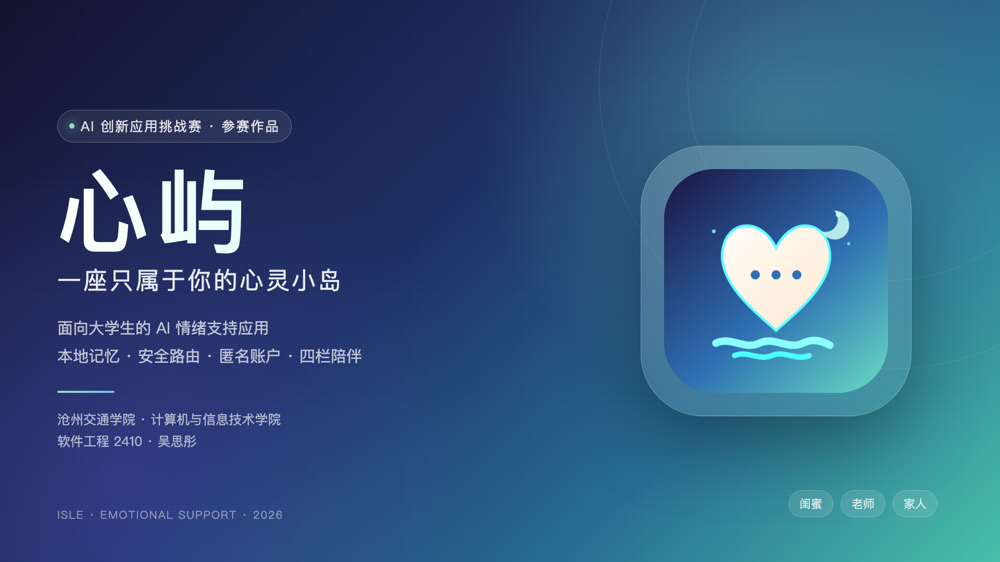
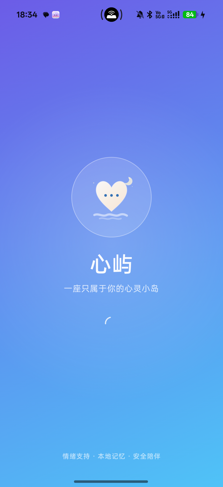
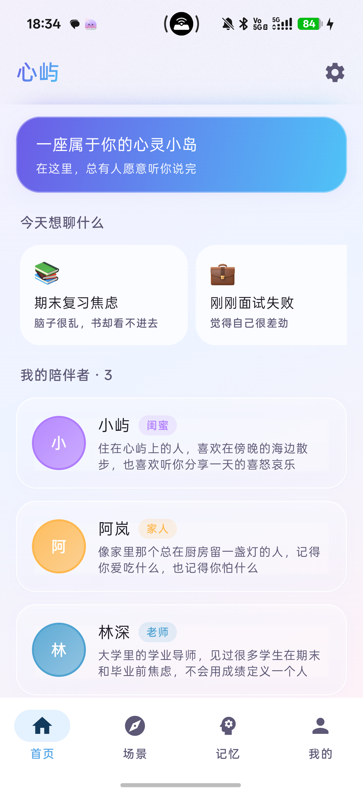
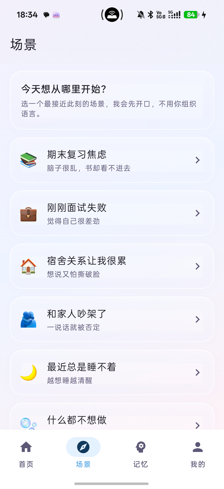
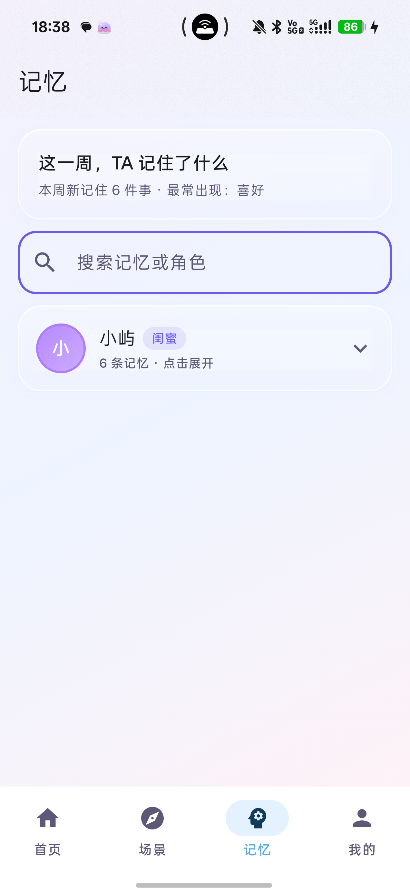
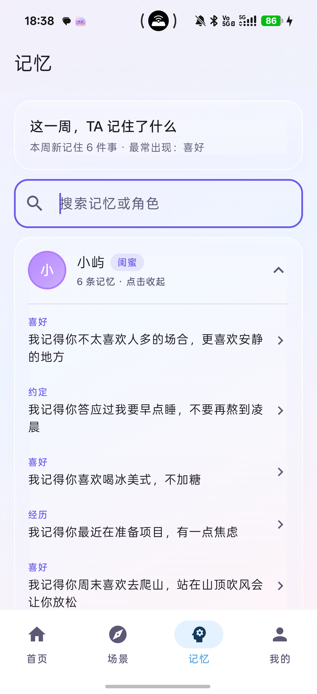
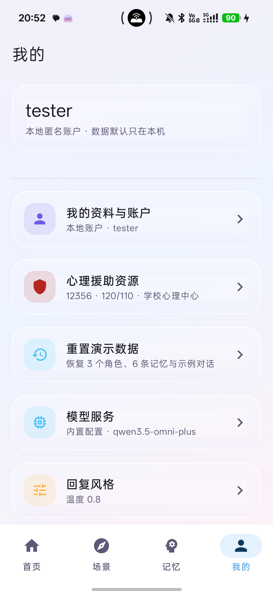

# 心屿（Isle）

> **一座会记住你的心灵小岛**
> 面向大学生的 AI 情绪支持应用




---

## 怎么读这份文档

如果你只想快速了解这个作品，先看「这是什么」「核心能力」和「产品截图」就够了。

如果你想运行或检查代码，直接跳到「10 分钟极速复现」和「测试与验证」。

如果你关心安全边界，重点看「多智能体安全路由」「本地匿名账户」和「隐私与安全」。

这份 README 写给开发者和技术评委，语言会尽量直白，但不会省略必要的技术细节。

---

## 这是什么

心屿是一款原生 Android **情绪支持应用**。

它用闺蜜、老师、家人三种角色，陪用户把情绪说出来、理清楚；提供 8 个预设场景、树洞/分析/呼吸等快捷模式，
并把长期记忆留在手机本地。

心屿不是心理咨询或医疗诊断工具，也不提供恋人式陪聊：

- 不诊断、不治疗、不承诺疗效；
- 不提供恋人角色，不进行恋爱/暧昧角色扮演；
- 高危/危机表达会暂停角色扮演，优先引导联系真人；
- 不收集年龄、身份证、学籍信息。

> 如果你正经历强烈痛苦或危机，请优先联系真人帮助，而不是只依赖应用。

---

## 产品边界

| 项目 | 边界 |
| --- | --- |
| 角色 | 闺蜜 / 老师 / 家人 / 朋友 / 自定义（非恋爱关系） |
| 适用人群 | 大学生及需要轻量情绪支持的成年人 |
| 不做 | 心理诊断、治疗、危机替代、恋爱陪伴 |
| 危机处理 | 固定话术 + 12356 / 120/110 / 学校心理中心 / 辅导员 |
| 数据 | 聊天、记忆、向量默认只在本机；账号只做本机身份识别 |

---

## 核心能力

### 1. 三角色与场景引导

| 能力 | 说明 |
| --- | --- |
| 三种固定角色 | 闺蜜「小屿」、家人「阿岚」、老师「林深」 |
| 自定义角色 | 名称 / 性格 / 背景 / 说话风格 / 开场白；不提供恋爱关系 |
| 八个预设场景 | 期末焦虑、面试失败、宿舍关系、家庭冲突、失眠、低动力、孤独、只想被听见 |
| AI 主动开场 | 选场景后由 AI 先开口，用户不用先组织语言 |
| 快捷模式 | 自由聊 / 听我吐槽 / 帮我分析 / 陪我呼吸 / 场景引导 |

### 2. 四栏导航与启动体验

- 冷启动品牌封面约 1.4 秒，然后进入登录/锁屏；
- 底部四栏：**首页 / 场景 / 记忆 / 我的**；
- 聊天、角色编辑、账户等二级页面自动隐藏底部栏；
- 新图标：深海渐变 + 心形对话空间 + 消息点 + 月牙与涟漪。

### 3. 多智能体安全路由

| 机制 | 说明 |
| --- | --- |
| 情绪/风险检测 | `SafetyEngine` 本地规则优先，输出 L0–L3 风险等级 |
| 安全策略路由 | `ConversationOrchestrator` 确定性状态机，高危/危机不调用模型 |
| 输出校验 | `ResponseValidator` 拦截 AI 身份暴露、危险方法、倾听模式给建议 |
| 危机支持 | 固定话术，角色扮演暂停；12356 / 120/110 / 学校心理中心 |
| 可解释 | 聊天页可查看“情绪 / 风险 / 路由 / 模式”的结构化说明 |

### 4. 本地长期记忆

| 能力 | 说明 |
| --- | --- |
| 自动抽取 | 每轮对话后由 LLM 提炼值得记住的事实 |
| 端侧向量化 | `bge-small-zh-v1.5` int8，512 维，在手机本地推理 |
| 语义召回 | 语义 0.8 + 关键词 0.2 + 重要度 0.1，Top-6 注入 |
| 角色隔离 | 每个角色独立记忆库 |
| 折叠管理 | 记忆页按角色折叠；展开查看，点「管理」进入该角色记忆管理 |
| 可编辑 | 搜索、编辑、删除、清空 |
| 安全 | 高危/危机对话不写入长期记忆 |

### 5. 本地匿名账户

| 机制 | 说明 |
| --- | --- |
| 本地注册/登录 | 昵称 + 密码，不联网、不收集手机号/邮箱/实名 |
| 密码保护 | PBKDF2WithHmacSHA256，随机盐，210,000 次迭代 |
| 恢复码 | 只显示一次，可验证当前密码后重新生成 |
| 应用锁 | 后台超过 60 秒回到前台需要重新解锁；5 次失败锁定 |
| 删除账户 | 清除账户、角色、聊天、记忆、图片、模型配置与资料 |
| 能力边界 | 只做本机身份识别，不做学籍/实名核验 |

### 6. 对话体验

- SSE 流式回复，逐字出现；
- 支持图片输入与大图查看；
- 失败重试不污染历史；
- 停止生成保留已收到内容；
- 清空会话同时清理聊天图片；
- 输入框获得焦点后自动重试拉起键盘，兼容懒加载/插件式第三方输入法；
- 聊天页展示角色主题色与 Agent Trace。

### 7. 情绪手账

结束一段深度对话后，点聊天页右上角 ✨ 或「生成手账」：

- LLM 从对话中提炼一句金句、标题和情绪；
- 生成 1080×1440 的品牌渐变手账图；
- 右下角自带渠道二维码，指向 `share/index.html` 落地页；
- 点「保存图片」保存到 `Pictures/心屿/`，再分享至朋友圈或小红书。

二维码地址可通过 `local.properties` 的 `SHARE_QR_URL` 配置；当前落地页为 <https://isle.ynatech.xyz/>。

---

## 产品截图

| 启动封面 | 首页 / 四栏导航 |
| --- | --- |
|  |  |

| 场景 | 记忆折叠 |
| --- | --- |
|  |  |

| 记忆展开 | 我的 |
| --- | --- |
|  |  |

---

## 10 分钟极速复现

### 环境要求

| 依赖 | 版本 | 说明 |
| --- | --- | --- |
| JDK | 17+ | 构建使用 JDK 17 字节码 |
| Android SDK | Platform 37 / Build-Tools 36 | `minSdk 26`、`compileSdk 37` |
| Gradle | 9.6.0 | 随仓库提供 Wrapper |
| 网络 | 可访问 Google Maven / Maven Central | 首次构建需拉取依赖 |

> 不需要 Android Studio，命令行即可构建、安装与测试。

### ① 克隆仓库

```bash
git clone https://github.com/ynamlu/isle.git
cd isle
```

### ② 配置 Android SDK

创建 `local.properties`（已被 `.gitignore` 排除）：

```properties
# macOS
sdk.dir=/Users/你的用户名/Library/Android/sdk
# Windows
# sdk.dir=C\:\\Users\\你的用户名\\AppData\\Local\\Android\\Sdk
# Linux
# sdk.dir=/home/你的用户名/Android/Sdk
```

### ③ 配置模型服务

在 `local.properties` 中直接填写模型服务地址、模型 ID 和 Key：

```properties
AI_BASE_URL=https://maas.qianwenaiapi.com/compatible-mode/v1
AI_MODEL=deepseek-v4.1-flash-1017
AI_API_KEY=sk-你的密钥
```

优先级：**应用内设置 > local.properties 注入 > 通用默认值**。

`local.properties` 不入库，但构建时 Key 会写入 BuildConfig，最终进入 APK。
因此这个配置只适合私有演示或比赛提交；公开分发前请轮换 Key，并重新打包。

### ④ 构建

```bash
./gradlew assembleDebug          # macOS / Linux
gradlew.bat assembleDebug        # Windows
```

产物：

```text
app/build/outputs/apk/debug/app-arm64-v8a-debug.apk   # 现代手机
app/build/outputs/apk/debug/app-armeabi-v7a-debug.apk # 旧机型
```

### ⑤ 安装

```bash
adb install -r app/build/outputs/apk/debug/app-arm64-v8a-debug.apk
```

首次启动：

```text
品牌封面 → 创建本地账户 / 先体验 → 首页
```

### ⑥ 测试

```bash
# 一键复现：检查 JDK / SDK → 单测 → 构建 → 输出 APK SHA
./scripts/reproduce.sh

./gradlew :app:testDebugUnitTest
./gradlew connectedDebugAndroidTest
./gradlew :app:testDebugUnitTest --tests '*OpenAiClientE2eTest*' -Disle.e2e=1
./scripts/verify-ai-connection.sh
```

---

## 技术架构

```text
UI 层（Compose）
  Screen ←→ ViewModel（StateFlow 单向数据流）
  四栏导航 / 角色 / 场景 / 聊天 / 记忆 / 我的

Domain 层
  conversation  · 安全路由 / 多智能体编排
  safety        · 情绪与风险检测 / 输出校验
  scenario      · 八个引导场景
  memory        · 分词 / 向量 / 抽取 / 召回
  prompt        · 系统提示词组装

Data 层
  Room（characters / messages / memories）
  DataStore（设置 / 用户资料）
  OpenAiClient（OpenAI 兼容 / SSE / 多模态）
  LocalAuthRepository（本地账户 / PBKDF2 / 恢复码）

基础设施
  AppContainer（手写依赖容器）
  AvatarStorage（图片分级压缩）
  ONNX Runtime（端侧向量）
```

### 一次对话的链路

```text
用户输入
  → SafetyEngine 情绪/风险检测
  → ConversationOrchestrator 路由
      ├─ 高危/危机：固定安全话术，不调用模型
      └─ 日常：PromptBuilder 组装角色 + 场景 + 记忆
  → OpenAiClient SSE 流式回复
  → ResponseValidator 输出校验
  → 落库 / 记忆抽取 / Agent Trace
```

### 端侧记忆

- `bge-small-zh-v1.5` int8，512 维，23.9MB；
- WordPiece 分词 + CLS 池化 + L2 归一化；
- Room BLOB 存储向量；
- 召回：语义 0.8 + 关键词 0.2 + 重要度 0.1；
- 向量不可用时自动降级为关键词匹配。

### 本地账户

- PBKDF2WithHmacSHA256 + 随机盐 + 210,000 次迭代；
- Android Keystore 加密账户数据；
- 恢复码只存哈希；
- 应用锁 60 秒；
- 删除账户清空本地数据。

### 模型接入与本地配置

当前版本直接连接千问 MaaS：

```text
App（AI_BASE_URL + AI_MODEL + AI_API_KEY）
  → 千问 MaaS /chat/completions
```

- 模型地址、模型 ID、Key 来自 `local.properties`，构建时注入 BuildConfig；
- 默认模型为 `deepseek-v4.1-flash-1017`；
- 换 Key 或换模型需要更新 `local.properties` 并重新打包；
- Key 会进入 APK，可能被反编译提取，因此只适合私有演示或比赛提交；
- 公开分发前请轮换 Key，或改成用户自带 Key（BYOK）模式。

---

## 技术栈

| 层次 | 选型 | 版本 |
| --- | --- | --- |
| 语言 | Kotlin | 2.3.21 |
| 构建 | AGP / Gradle | 9.4.1 / 9.6.0 |
| 界面 | Jetpack Compose + Material 3 | BOM 2026.09.00 |
| 导航 | Navigation Compose | 2.10.2 |
| 视觉 | Haze | 2.0.1 |
| 本地数据库 | Room | 2.8.5 |
| 键值配置 | DataStore Preferences | 1.2.1 |
| 网络 | Retrofit / OkHttp / okhttp-sse | 3.0.0 / 5.5.0 |
| 模型协议 | OpenAI 兼容 | — |
| 序列化 | kotlinx.serialization | 1.11.0 |
| 端侧推理 | ONNX Runtime Android | 1.31.0 |
| 端侧模型 | bge-small-zh-v1.5 int8 | 512 维 / 23.9MB |
| 手账二维码 | ZXing core | 3.5.3 |
| 图片 | Coil | 3.4.0 |

---

## 项目结构

```text
Isle/
├── app/src/main/
│   ├── java/com/isle/companion/
│   │   ├── MainActivity.kt                  # 封面 / 账户锁 / 主界面
│   │   ├── di/AppContainer.kt               # 手写依赖容器
│   │   ├── data/
│   │   │   ├── auth/                        # 本地账户 / PBKDF2 / 恢复码
│   │   │   ├── local/                       # Room：实体 / DAO / 数据库
│   │   │   ├── prefs/                       # DataStore：配置 / 资料
│   │   │   ├── remote/                      # OpenAI 兼容客户端 / SSE
│   │   │   ├── repository/                  # 角色 / 会话 / 记忆
│   │   │   └── demo/                        # 演示数据
│   │   ├── domain/
│   │   │   ├── chat/                        # 多智能体编排
│   │   │   ├── safety/                      # 风险检测 / 输出校验
│   │   │   ├── scenario/                    # 场景库
│   │   │   ├── memory/                      # 分词 / 向量 / 抽取
│   │   │   └── prompt/                      # 提示词组装
│   │   ├── ui/
│   │   │   ├── navigation/                  # 四栏导航
│   │   │   ├── screen/splash/               # 品牌封面
│   │   │   ├── screen/auth/                 # 登录 / 锁屏
│   │   │   ├── screen/character/            # 角色
│   │   │   ├── screen/scenario/             # 场景
│   │   │   ├── screen/chat/                 # 聊天
│   │   │   ├── screen/memory/               # 记忆
│   │   │   ├── screen/settings/             # 我的 / 设置
│   │   │   └── theme/                       # 设计系统 / 玻璃
│   │   └── util/                            # 图片存储
│   ├── assets/embedding/                    # 端侧向量模型
│   └── res/                                 # 图标 / 主题 / 资源
├── app/src/test/                            # JVM 单测
├── app/src/androidTest/                     # 仪器化测试
├── docs/                                    # 交付文档与截图
├── share/                                   # 情绪手账二维码落地页
└── gradle/                                  # 版本目录 / Wrapper
```

---

## 测试与验证

| 维度 | 手段 | 结果 |
| --- | --- | --- |
| 编译 | `assembleDebug` | BUILD SUCCESSFUL |
| JVM | 安全路由 / 输出校验 / 密码 / 场景 / URL / SSE / DTO | **60 tests，0 failures** |
| 仪器 | 记忆隔离 + 端侧向量 | 2 tests，0 failures（真机） |
| 真机 | CPH2747 / Android 17 | 注册 / 锁定 / 场景 / 危机拦截 / 记忆折叠 / 四栏导航 |
| 模型直连 | 千问 MaaS | `/v1/models` 200 / SSE 正常 / 2.1MB 图片请求 200 |
| 向量 | `TextEmbedderTest` | 相似句 0.85 / 无关句 0.39 |
| 包体 | arm64 debug | 约 68MB（含 ONNX 模型） |

---

## 交付文档

```text
docs/
├── markdown/      # 所有可编辑源文档
├── pdf/           # 导出的交付 PDF
├── screenshots/   # 当前版本界面截图
├── 封面.png
└── 心屿-新图标.png
```

| 文档 | 内容 |
| --- | --- |
| [`docs/markdown/技术文档.md`](docs/markdown/技术文档.md) · [PDF](docs/pdf/技术文档-心屿.pdf) | 意图控制、架构、记忆、安全路由、本地账户、模型配置与可复现性 |
| [`docs/markdown/用户使用说明书.md`](docs/markdown/用户使用说明书.md) · [PDF](docs/pdf/用户使用说明书.pdf) | 面向用户的操作指南 |
| [`docs/markdown/作品介绍.md`](docs/markdown/作品介绍.md) · [PDF](docs/pdf/作品介绍.pdf) | 项目详情、使用方式、亮点、AI 测试、关键技术、图片、获奖与原创性说明 |
| [`docs/markdown/需求分析.md`](docs/markdown/需求分析.md) · [PDF](docs/pdf/需求分析.pdf) | 背景、用户场景、功能与非功能需求、验收标准与需求追踪 |
| [`docs/markdown/开发与AI协同全记录.md`](docs/markdown/开发与AI协同全记录.md) · [PDF](docs/pdf/开发与AI协同全记录.pdf) | 开发过程、完整 AI 对话与 Prompt 历史 |
| [`docs/markdown/测试报告.md`](docs/markdown/测试报告.md) · [PDF](docs/pdf/测试报告.pdf) | 自动化测试、真机回归、安全专项、缺陷记录 |

---

## 隐私与安全

- 聊天、记忆、向量默认只存本机；
- 模型地址、模型 ID 和 Key 从 `local.properties` 注入，构建后进入 APK；
- 因此 APK 只适合比赛演示或私有分发，公开前必须轮换 Key；
- 发送消息时，内容会传输至模型服务用于生成回复；
- 本地账户不收集手机号、邮箱、实名信息；
- 删除账户会清除本地数据；
- 危机内容不写入长期记忆。

---

## 已知限制

- 无语音输入 / TTS；
- 无生物识别解锁；
- 无跨设备同步 / 云备份；
- 本地风险规则可能有误判；
- 本地账户无法做学籍/实名核验；
- 当前为 debug 签名，正式分发前需 release keystore；
- 模型 Key 会进入 APK，公开分发前必须轮换或改用 BYOK。

---

## 仓库

- GitHub：<https://github.com/ynamlu/isle>
- 作者：沧州交通学院 · 计算机与信息技术学院 · 软件工程 2410 · 吴思彤
- 版本：`v2.3.4`（versionCode 17）
