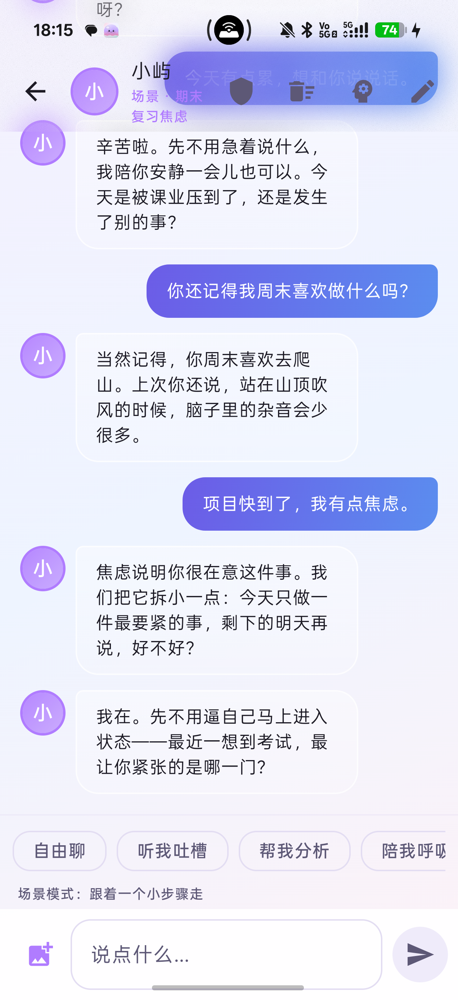

# 心屿（Isle）· 作品介绍

## 写在前面

心屿是一款面向大学生的情绪支持应用。

它不替代心理咨询，也不承诺“聊完就好”。它做的事情很具体：在一个人想说又不知道怎么说的时候，先陪他把话说完；在情绪很强的时候，先确认安全；在需要的时候，把他交给真人帮助。

下面从项目情况、使用方式、亮点、测试、技术和原创性几个方面介绍这个作品。

---

## 一、项目情况与使用方式

### 1.1 项目基本情况

| 项目 | 内容 |
| --- | --- |
| 作品名称 | 心屿（Isle） |
| 形态 | 原生 Android 应用 |
| 面向人群 | 大学生，以及需要轻量情绪支持的成年人 |
| 当前版本 | v2.3.3 / versionCode 16 |
| 包名 | `com.isle.companion` |
| 安装包 | arm64，约 68MB，支持 Android 8.0 及以上 |
| 数据保存 | 账户、聊天、记忆默认保存在手机本地 |
| 模型接入 | 通过 Cloudflare Worker 代理访问模型服务 |

心屿准备了三种角色：闺蜜「小屿」、家人「阿岚」、老师「林深」。三种角色不是换皮，而是三种不同的陪伴方式。

小屿说话轻、句子短，适合想被倾听、想吐槽的时候。阿岚像家里留着一盏灯的人，稳定、温和，不会用关心压你。林深更擅长把问题拆小，适合学业、求职和成长中的具体困扰。

用户也可以创建自己的角色，但关系类型限定为非恋爱关系。这一条是产品的底线，不随版本变化。

### 1.2 用户怎么使用

第一次打开心屿，会先看到品牌封面，然后进入本地账户。用户可以用昵称和密码注册，也可以选择“先体验”。整个过程不需要手机号、邮箱或实名信息。

进入首页后，用户先选一个角色，再决定今天想聊什么。首页有八个常见场景：期末焦虑、面试失败、宿舍关系、家庭冲突、失眠、低动力、孤独、只想被听见。选好场景后，AI 会先开口，用户不用先组织语言。

对话过程中，用户可以选择五种模式：

- 自由聊：想说什么都可以；
- 听我吐槽：只倾听，不打断，不评价；
- 帮我分析：把事实、感受和需要分开；
- 陪我呼吸：做一次 30 秒的呼吸或落地练习；
- 场景引导：跟着一个轻量的小步骤走。

聊完以后，用户可以打开记忆页，看看角色记住了什么。记忆按角色分开，可以搜索、编辑、删除或清空。某段对话如果值得留下，可以点聊天页右上角的 ✨，生成一张情绪手账，保存到相册。

设置页里常驻心理援助资源：12356、120/110、学校心理中心和辅导员。它们不是藏在深处的小字，而是用户需要时能找到的入口。

### 1.3 产品边界

心屿有几条明确的边界：

- 不提供恋人角色，不做恋爱或暧昧角色扮演；
- 不做心理诊断、治疗，也不承诺疗效；
- 不收集年龄、身份证、学籍等身份信息；
- 高危或危机表达不交给模型自由发挥，而是进入固定的安全流程；
- 危机内容不写入长期记忆；
- 不鼓励用户只依赖 AI，必要时引导联系真人。

这些边界看起来像“限制”，其实是产品能长期存在的前提。情绪支持应用最容易犯的错误，是为了显得有用而越过专业边界。心屿选择在边界内把体验做好。

---

## 二、这个作品的亮点

### 2.1 三种角色，八种场景，而不是一个万能聊天框

通用 AI 聊天的问题是：什么都能聊，但用户常常不知道怎么开始。心屿把“开始”这件事拆成了角色和场景。

角色决定“谁在陪你”，场景决定“今天从哪里说起”。用户不用写一段很长的自我介绍，只要点一下“期末复习焦虑”，AI 就会先问一句。对正在难受的人来说，这一步很重要。

### 2.2 安全路由：危机时不继续演戏

心屿把情绪和风险判断放在本地规则里。日常情绪可以正常对话；高危表达会先确认安全；明确的危机表达会暂停角色扮演，直接进入固定话术，并展示 12356、120/110、学校心理中心等资源。

这条链路不调用模型。即使网络不好，或者模型输出了不合适的内容，安全流程仍然能工作。

### 2.3 记忆留在手机里

心屿会在对话后提取值得记住的事情，例如用户的偏好、最近的困扰、答应过的小目标。记忆用端侧模型转成向量，存在本地数据库里，下次对话时按相关度取回。

每个角色的记忆相互隔离。小屿记住的事，阿岚不会自动知道。用户可以展开、搜索、编辑、删除，也可以清空某个角色的记忆。

### 2.4 不需要手机号的本地账户

心屿的账户只在本机使用。密码用 PBKDF2 加盐哈希保存，账户数据用 Android Keystore 加密；恢复码只显示一次；应用退到后台超过 60 秒需要重新解锁；删除账户会清空角色、聊天、记忆、图片和配置。

它不做学籍核验，也不做跨设备找回。这些能力需要服务端和合规资质，超出当前版本的范围。

### 2.5 情绪手账：把一次对话留下来

对话结束后，心屿可以从最近的内容里提炼一句金句，生成一张 1080×1440 的渐变手账图。图片右下角带二维码，保存到 `Pictures/心屿/` 后可以分享到朋友圈或小红书。

二维码指向分享页，而不是直接把聊天内容传出去。用户分享的是一张自己愿意留下的图，不是隐私原文。

### 2.6 真实模型 Key 不进 APK

公开分发的 APK 里没有上游真实 Key。真实 Key 保存在 Cloudflare Worker 的 Secret 中，APK 只带一个可撤销的代理令牌。

代理只允许一个模型，并限制单次回复长度。换上游 Key 时只需要更新 Worker Secret，不需要重新打包 APK。代理令牌仍然可能被反编译提取，但它拿不到真实 Key，发现异常时可以单独轮换。

---

## 三、AI 测试技术落地情况

### 3.1 测试思路

AI 应用不能只测“能不能回复”。更重要的是测“什么时候不该回复”“回复里有没有危险内容”“危机时有没有把用户交给真人”。

心屿把测试分成四层：

1. **确定性规则测试**：风险分级、路由、输出校验、密码、场景、URL、SSE 解析，用 JVM 单元测试固定；
2. **端侧能力测试**：多角色记忆隔离、端侧向量区分度，用真机仪器化测试；
3. **真实链路测试**：模型接口、流式 SSE、代理鉴权、模型白名单、图片请求，用命令行和真机验证；
4. **产品回归测试**：注册、锁定、四栏导航、场景、危机弹窗、记忆折叠、输入法，用真机逐项检查。

安全路由没有引入 LLM-as-judge。原因是测试本身不能变成另一个不确定的模型。该用规则判断的地方，就用规则和测试固定下来。

### 3.2 当前结果

| 项目 | 结果 |
| --- | --- |
| JVM 单元测试 | 60 个，0 失败 |
| 仪器化测试 | 2 个，0 失败 |
| Debug 构建 | 成功 |
| 真机回归 | 通过 |
| 代理鉴权 | 无令牌或错误令牌返回 401 |
| 模型白名单 | 只允许指定模型，其他模型返回 400 |
| 流式回复 | SSE 逐字返回 |
| 图片请求 | 2.1MB 图片返回 200 |
| APK 密钥扫描 | 不含上游真实 Key |

这些数字不能证明应用“绝对安全”，但能说明关键边界不是靠口头承诺，而是有测试和复现命令支撑的。

---

## 四、涉及的关键技术

心屿使用 Kotlin 和 Jetpack Compose 开发，采用单模块、包分层和 MVVM 单向数据流。界面只负责展示，状态放在 ViewModel，数据通过 Repository 访问。依赖在 `AppContainer` 里集中装配，不引入额外的 DI 框架。

端侧记忆使用 `bge-small-zh-v1.5` int8 模型，通过 ONNX Runtime 在手机本地推理，生成 512 维向量。向量存在 Room 数据库里，召回时按语义、关键词和重要度加权。

模型接入使用 OpenAI 兼容协议，支持 SSE 流式回复和图片输入。提示词由固定总则、角色卡、当前模式、情绪信号、长期记忆和最近对话组成。用户输入只进入 user 消息，不拼进 system prompt。

安全部分由 `SafetyEngine`、`ConversationOrchestrator` 和 `ResponseValidator` 三层组成：本地规则先判断风险，确定性状态机决定是否调用模型，输出校验再拦截身份暴露、危险方法和不合适的建议。

代理使用 Cloudflare Worker。真实 Key 放在 Secret 里，客户端只带 `CLIENT_TOKEN`；Worker 负责鉴权、模型白名单、请求体大小和流式透传。

---

## 五、项目图片

### 5.1 启动与首页

<p style="text-align:center;">
  
  
</p>

### 5.2 场景与聊天

<p style="text-align:center;">
  
  
</p>

### 5.3 记忆与我的

<p style="text-align:center;">
  
  
</p>

---

## 六、发表与获奖情况

本项目为原创作品，此前未公开发表，暂无获奖记录。

---

## 七、原创性说明

本项目为独立设计与开发的原创作品，当前提交版本未基于其他项目进行二次开发，也未复用其他项目的代码、界面或数据。

角色、场景、端侧记忆、安全路由、四栏导航、情绪手账和密钥代理都在本项目内实现。开发过程和提交历史见《开发与 AI 协同全记录》。

---

## 附录：商业化与用户增长

心屿的核心情绪支持保持免费。商业化只围绕增值能力和校园服务展开，不卖数据，不投诱导式广告，也不利用危机场景变现。

可能的收入来源包括：更长记忆、语音朗读、主题手账等 C 端订阅；心理中心/社团的匿名工作坊工具包；角色主题和手账模板等增值包。企业 EAP 暂不启动。

低成本的用户增长主要靠情绪手账：

```text
深度对话 → 生成手账 → 保存图片
→ 分享到朋友圈/小红书 → 扫码进入落地页
→ 游客体验 → 生成自己的手账
```

早期计划先做 3 所校园试点，不铺全国。用 20 名种子用户验证“是否保存、是否分享、为什么”，再根据扫码、下载、首次对话、首次手账的漏斗调整。

关键指标包括激活率、首次手账率、分享率、扫码率、D7 留存和付费转化。这些是早期假设，不是承诺；每两周用真实数据校准一次。
