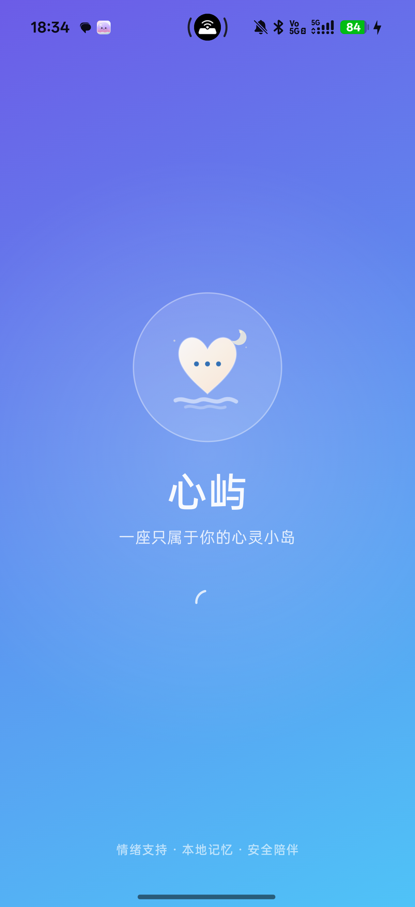
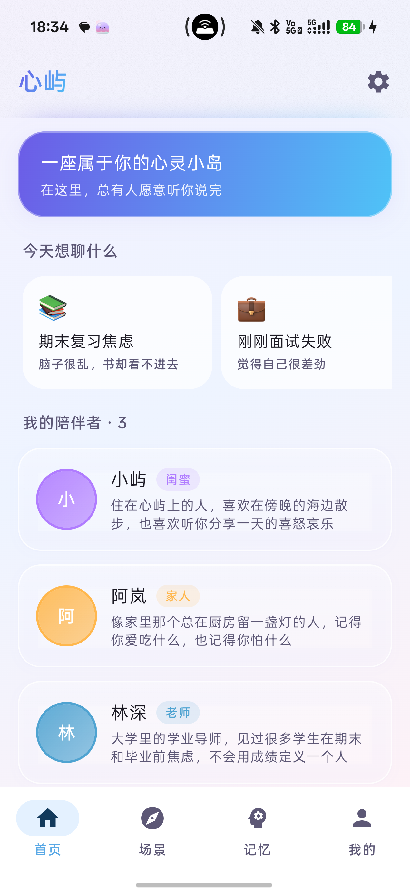
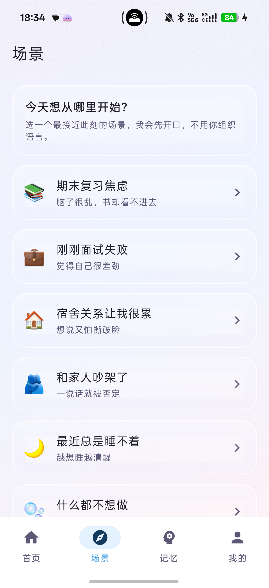
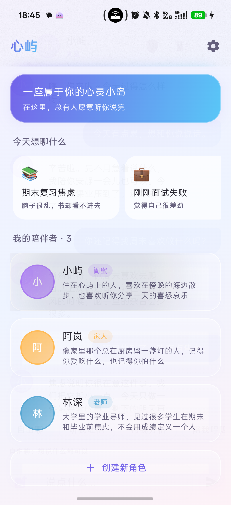
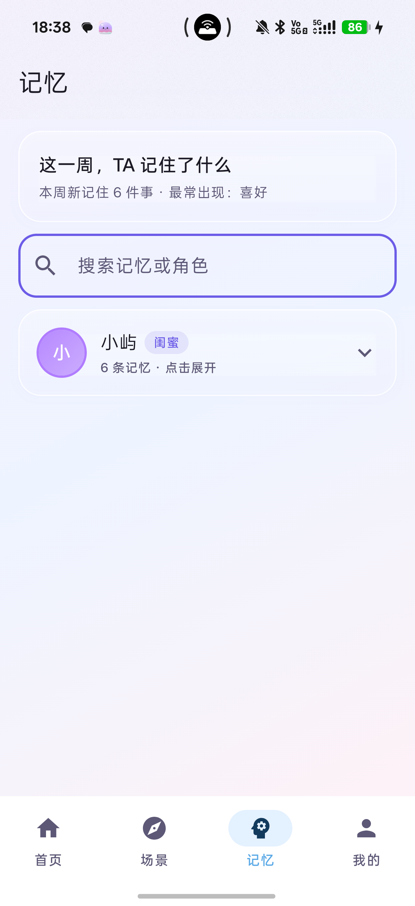
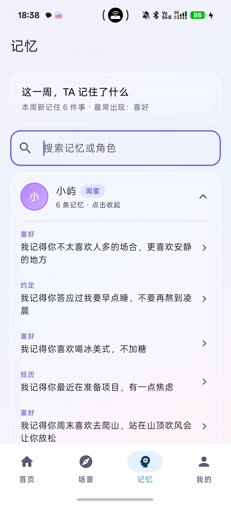
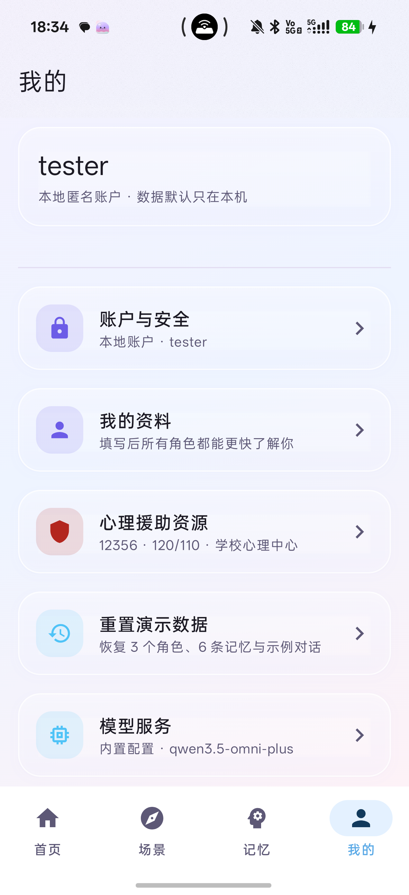
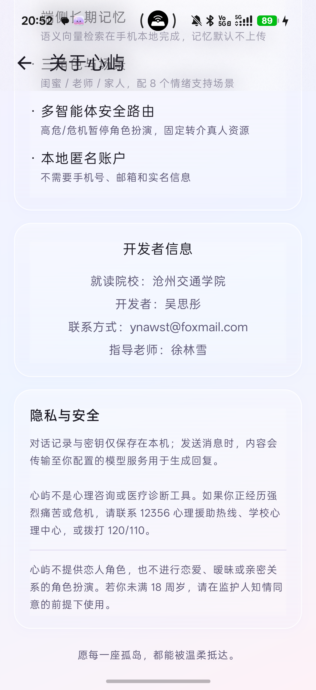

# 心屿（Isle）· 用户使用说明书

> 适用版本：v2.3.0
> 心屿提供情绪支持，不是心理咨询或医疗诊断。

---

## 一、安全边界

心屿不提供恋人角色，也不进行恋爱、暧昧或亲密关系的角色扮演。

- 不收集年龄、身份证、学籍等身份信息；
- 不诊断、不治疗、不承诺疗效；
- 高危/危机表达会暂停角色扮演，优先引导联系真人；
- 危机内容不写入长期记忆；
- 设置页「心理援助资源」常驻 12356、120/110、学校心理中心/辅导员。

> 如果你正经历强烈痛苦或危机，请优先联系真人帮助，而不是只依赖应用。

---

## 二、认识心屿

心屿是一款面向大学生的 AI 情绪支持应用。它想做的不是“更聪明的聊天工具”，
而是一个愿意等你说完、并且记得你说过什么的地方。

### 2.1 三种角色

| 角色 | 示例 | 适合 |
| --- | --- | --- |
| 闺蜜 | 小屿 | 想被倾听、吐槽、被接住情绪 |
| 家人 | 阿岚 | 想要稳定、温和、不说教的关心 |
| 老师 | 林深 | 想把学业/成长问题拆成小步骤 |

你也可以创建自己的角色，但关系类型限定为非恋爱关系。

### 2.2 四个底部入口

| 入口 | 内容 |
| --- | --- |
| 首页 | 角色列表 + 快速场景 |
| 场景 | 完整 8 个预设场景 |
| 记忆 | 跨角色记忆总览、折叠查看、管理 |
| 我的 | 我的资料与账户、心理援助资源、模型、风格、关于心屿 |

### 2.3 五种对话模式

- 自由聊：想说什么都可以；
- 听我吐槽：只倾听，不打断，不评价；
- 帮我分析：把事实、感受和需求分开；
- 陪我呼吸：30 秒呼吸/落地练习；
- 场景引导：跟着一个轻量的小步骤走。

---

## 三、安装与启动

### 3.1 安装

将 `心屿-v2.3.0-arm64.apk` 传到手机后点击安装。

安装包已预置代理服务，首次使用不需要填写 API Key；聊天时由心屿的 Cloudflare Worker 代理转发到模型服务。

> 若提示「未知来源应用」，请在系统设置中允许安装来自该来源的应用。

### 3.2 系统要求

| 项 | 要求 |
| --- | --- |
| Android 版本 | 8.0（API 26）及以上 |
| CPU 架构 | ARM64（推荐）或 ARMv7 |
| 存储空间 | 约 150 MB |
| 网络 | 调用模型服务时需要 |

### 3.3 启动流程

```text
品牌封面（约 1.4 秒）
  → 创建本地账户 / 先体验 / 登录
  → 首页
```



### 3.4 本地账户

首次启动可以：

- **创建本地账户**：昵称 + 密码；
- **先体验**：游客模式，不锁定应用；
- **已有账户登录**：输入密码。

本地账户不需要手机号、邮箱或实名信息。密码只在本机校验。

注册成功后会显示一次**恢复码**：

- 请抄下来或存进密码管理器；
- 忘记密码只能用恢复码重设；
- 如果没保存，可在「我的 → 我的资料与账户 → 重新生成恢复码」用当前密码生成新码，旧码立即失效。

### 3.5 应用锁

- 应用退到后台超过 60 秒，再回来需要重新解锁；
- 连续输错 5 次会锁定，等待时间逐步增加；
- 「我的 → 我的资料与账户」可以手动锁定应用。

---

## 四、首页与角色



首页包含：

- 顶部品牌卡；
- 「今天想聊什么」快速场景；
- 「我的陪伴者」角色列表；
- 「＋ 创建新角色」。

### 4.1 进入聊天

点击任意角色卡片 → 进入聊天页。

### 4.2 创建角色

1. 首页「＋ 创建新角色」；
2. 填写名称、关系类型、性格、背景、说话风格、开场白；
3. 可上传头像；
4. 保存。

关系类型为：闺蜜 / 老师 / 朋友 / 家人 / 自定义；不提供恋人。

### 4.3 编辑 / 删除角色

聊天页右上角 ✏️ → 编辑角色。

删除角色会同时清除：

- 该角色的聊天记录；
- 该角色的长期记忆；
- 头像与聊天图片。

---

## 五、场景



底部「场景」Tab 提供 8 个预设场景：

1. 期末复习焦虑
2. 刚刚面试失败
3. 宿舍关系让我很累
4. 和家人吵架了
5. 最近总是睡不着
6. 什么都不想做
7. 我好像很孤独
8. 只是想被听见

使用方式：

```text
选场景 → 选角色 → AI 主动开场 → 跟着一个小步骤走
```

场景不是固定剧本，AI 会先共情，再根据你的回应推进，不会一次抛出所有问题。

---

## 六、聊天



### 6.1 发送文字

在底部输入框输入内容 → 点击发送按钮。

AI 会逐字流式回复。生成过程中，发送按钮会变成「停止」，点击可保留已生成的部分。

### 6.2 快捷模式

输入框上方可以切换：

- 自由聊
- 听我吐槽
- 帮我分析
- 陪我呼吸
- 场景引导（从场景进入时显示）

模式会影响 AI 的回复方式。例如「听我吐槽」会只倾听、不打断、不评价。

### 6.3 发送图片

1. 点击输入框左侧图片按钮；
2. 选择相册或拍照；
3. 图片会显示为待发送预览；
4. 点击发送。

点击聊天中的图片可全屏查看，支持双指缩放与拖动。

### 6.4 失败与重试

- 网络失败时，底部提示错误；
- 点「重试」会重新发送最后一条用户消息；
- 错误文案不会写成正常助手回复，不污染历史。

### 6.5 停止生成

生成中点「停止」：

- 已收到的部分会保留；
- 没有内容时不会留下空消息。

### 6.6 清空会话

聊天页右上角 🗑 → 清空当前会话和聊天图片。

### 6.7 安全模式

当输入被识别为高危/危机表达时：

- 角色扮演立即暂停；
- 出现「先确认你的安全」弹窗；
- 固定展示 12356、120/110、学校心理中心/辅导员；
- 危机内容不写入长期记忆。

点击「我知道了」后进入安全模式；确认安全后，下一次正常对话会回到自由聊。

### 6.8 Agent Trace

聊天页顶部的安全图标可以查看：

- 本轮情绪；
- 风险等级；
- 路由模式；
- 角色/场景信息。

只展示结构化决策，不展示模型内部推理。

### 6.9 情绪手账

结束一段深度对话后，可以点聊天页右上角的 ✨，或输入框上方的「生成手账」。

心屿会自动：

1. 从对话中提炼一句值得留下的金句；
2. 生成一张品牌渐变色的情绪手账图；
3. 在右下角放入渠道二维码。

预览页点「保存图片」，图片会保存到系统相册：

```text
Pictures/心屿/isle_journal_*.png
```

保存后可以自己发到朋友圈、小红书等平台。二维码指向的落地页由 `share/index.html` 部署，地址可通过 `SHARE_QR_URL` 配置。

---

## 七、记忆

### 7.1 记忆从哪里来

每轮对话后，角色会从对话中提炼值得长期记住的事实，例如：

- 你的生日；
- 你喜欢/不喜欢的事；
- 你最近在准备什么；
- 你答应过的事。

记忆以角色第一人称书写，不是冷冰冰的资料条目。

### 7.2 记忆页

底部「记忆」Tab 按角色分组：



- 默认收起；
- 点击角色卡片展开；
- 再点一次收起；
- 搜索时自动展开匹配角色；
- 展开状态在返回详情/切换 Tab 后保持。



### 7.3 管理记忆

每个角色组右侧有「管理」按钮：

```text
记忆 → 展开角色 → 点「管理」→ 记忆管理
```

在「记忆管理」页可以：

- 搜索该角色的记忆；
- 编辑记忆；
- 删除单条记忆；
- 清空该角色全部记忆。

### 7.4 记忆隔离

每个角色有独立记忆库，互不串台。删除角色会级联删除其记忆。

### 7.5 本周回顾

记忆页顶部显示：

- 本周新记住多少件事；
- 最常出现的记忆类别。

---

## 八、我的



### 8.1 我的资料与账户

账户管理与个人资料已合并为一页：

- 查看本地账户昵称与创建时间；
- 锁定应用；
- 修改密码；
- 重新生成恢复码；
- 删除本地账户与全部数据；
- 填写称呼、性格、自述；资料对所有角色共享。

> 与长期记忆的区别：我的资料是你主动告知的、全局共享；长期记忆是角色自行记住的、每个角色独立。

### 8.2 心理援助资源

常驻展示：

- 12356 全国心理援助热线（以当地开通情况为准）；
- 120 / 110；
- 学校心理中心 / 辅导员；
- 身边可信任的人。

### 8.3 模型服务

正式安装包默认使用心屿的代理服务，**普通用户不需要填写 API Key**：

- 上游真实 Key 保存在 Cloudflare Worker，不进入手机；
- App 只携带可撤销的代理令牌；
- 代理限制可用模型与单次回复长度。

高级用户仍可在「我的 → 模型服务」中切换到自己的服务：

- 地址；
- 模型 ID；
- API Key；
- 最大回复 tokens；
- 获取模型列表；
- 测试连接。

支持 OpenAI / DeepSeek / 通义千问 / 千问 MaaS / 本地 Ollama 等兼容 OpenAI 协议的服务。

### 8.4 回复风格

调整温度，控制回复的稳定/活泼程度。

### 8.5 关于心屿



包含：

- 心屿介绍与“为什么做心屿”；
- 技术亮点：端侧记忆、三角色与场景、多智能体安全路由、本地匿名账户；
- 开发者信息：
  - 就读院校：沧州交通学院
  - 开发者：吴思彤
  - 联系方式：ynawst@foxmail.com
  - 指导老师：徐林雪
- 隐私与安全说明、心理援助热线。

### 8.6 重置演示数据

恢复 3 个角色、6 条记忆、7 条示例对话。

---

## 九、隐私与数据

| 数据 | 存在哪 | 是否上传 |
| --- | --- | --- |
| 账户、密码哈希、恢复码哈希 | 本机加密存储 | 否 |
| 角色、聊天、记忆、向量 | 本机 Room | 默认否 |
| 模型服务配置 | 本机 DataStore | 否 |
| 上游真实 API Key | Cloudflare Worker Secret | 否（不在手机） |
| 发送的消息 | 经代理传输至模型服务 | 是（生成回复所需） |

- 本地账户不收集手机号、邮箱、实名信息；
- 删除账户会清除本地数据；
- 高危/危机内容不写入长期记忆；
- 安装包不含上游真实 Key，只含可撤销的代理令牌；
- 代理令牌仍可能被提取，但无法换取真实 Key，且受模型白名单与回复长度限制。

---

## 十、常见问题

**Q：忘记密码怎么办？**
用注册时保存的恢复码重设；如果恢复码也丢了，只能删除账户重新开始。

**Q：恢复码在哪里看？**
旧恢复码不会明文保存，无法查看；可在「我的 → 我的资料与账户 → 重新生成恢复码」用当前密码生成新码。

**Q：为什么没有恋人角色？**
心屿不做恋爱/暧昧角色扮演，避免情感依赖和内容风险。

**Q：记忆会上传吗？**
记忆和向量默认只在本机；发送消息时，消息内容会传输至你配置的模型服务。

**Q：键盘弹不出来怎么办？**
输入框获得焦点后，心屿会自动重试拉起键盘，兼容懒加载或插件式第三方输入法。如果仍然不弹出，请检查系统输入法设置，或切换到 Gboard / 系统输入法。

**Q：需要自己填 API Key 吗？**
不需要。正式安装包已预置代理服务。只有想使用自己的模型账号时，才需要在「模型服务」里填写地址、模型和 Key。

**Q：可以换模型吗？**
可以。支持 OpenAI 兼容协议，地址、模型、Key 都可替换；使用默认代理时只能选择代理开放的模型。

**Q：如何清空某个角色的记忆？**
记忆 Tab → 展开角色 → 点「管理」→ 清空记忆。

---

## 十一、免责声明

- 本应用为个人开发的情绪支持应用，不替代专业心理咨询或医疗诊断；
- AI 回复由大语言模型生成，可能存在不准确或不当之处；
- 若你正经历持续的情绪困扰或危机，请及时联系专业机构、学校心理中心或拨打 12356 / 120 / 110；
- 使用本应用即表示你理解并接受上述边界。
