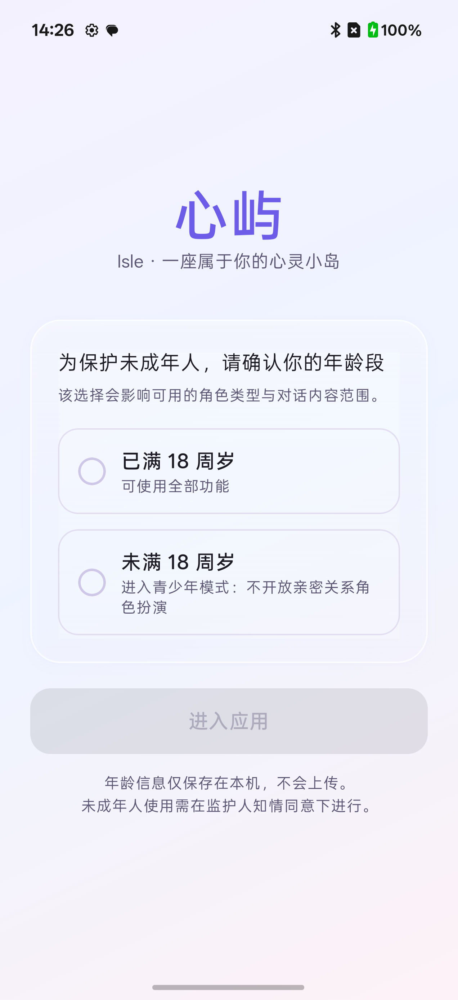
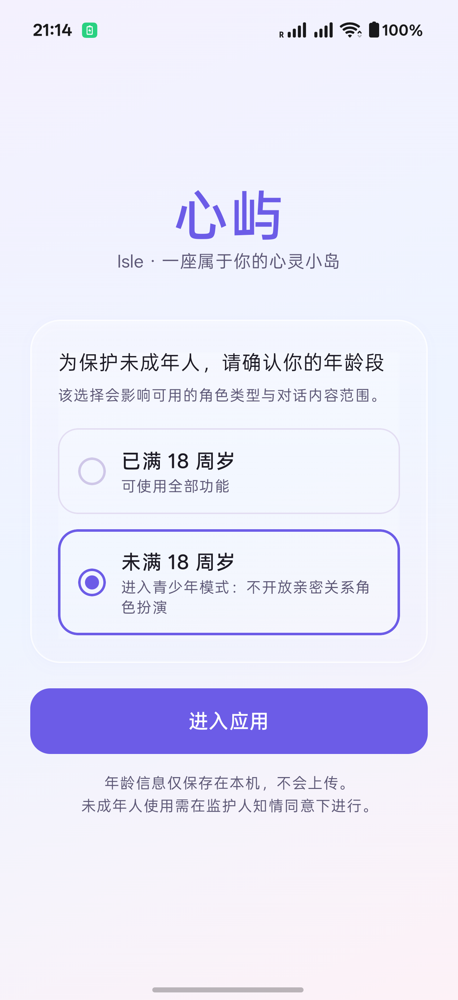
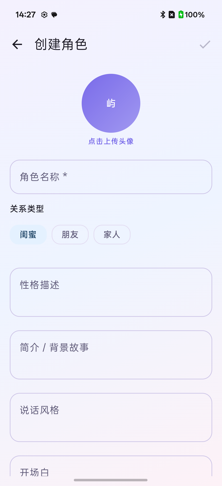
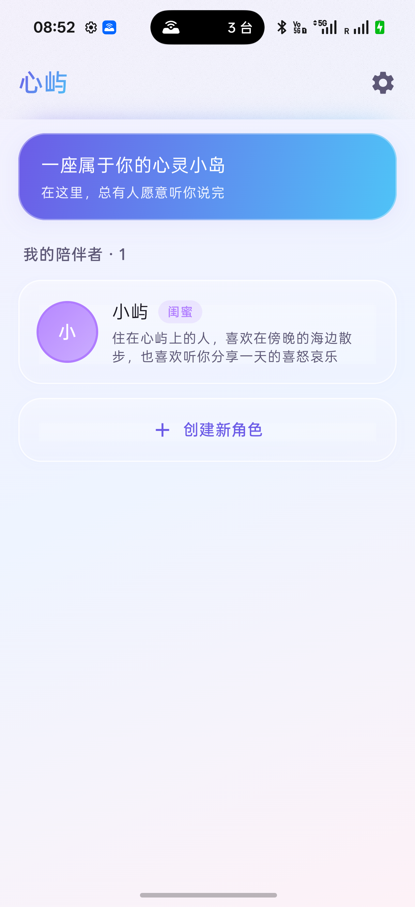
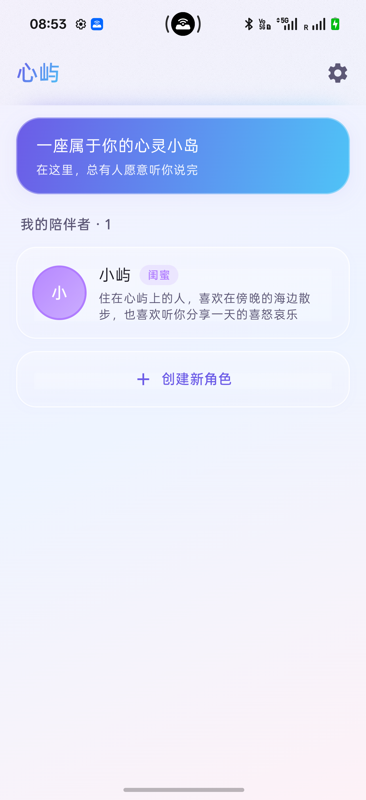
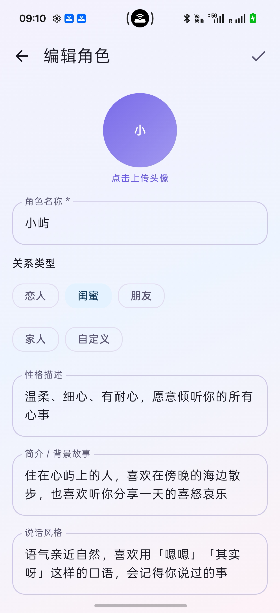
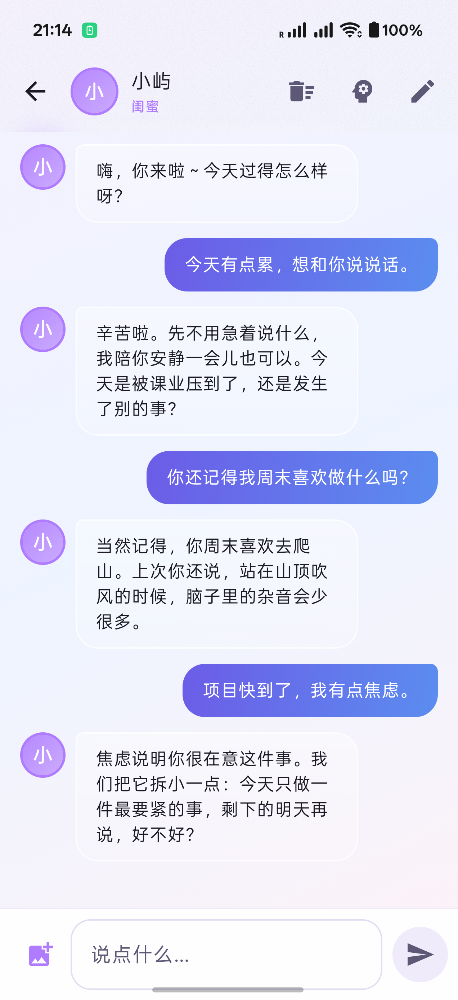
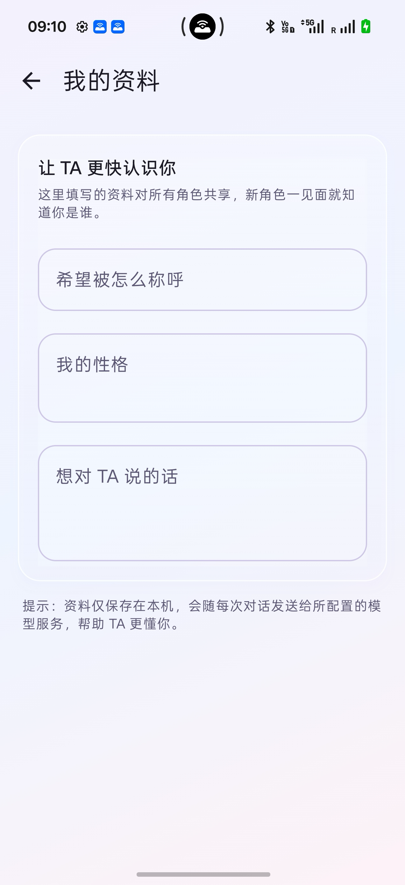
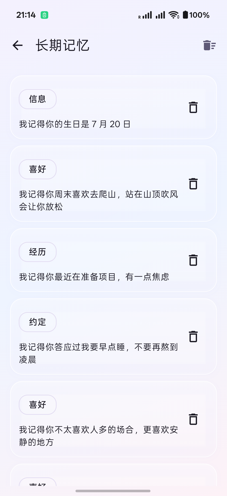

# 心屿（Isle）· 用户使用说明书

> 适用版本：v1.0.0　|　心屿项目作品

## 目录

- [一、年龄确认与青少年模式](#一年龄确认与青少年模式)
- [二、认识心屿](#二认识心屿)
- [三、安装与启动](#三安装与启动)
- [四、首次配置](#四首次配置)
- [五、角色管理](#五角色管理)
- [六、开始聊天](#六开始聊天)
- [七、我的资料](#七我的资料)
- [八、长期记忆](#八长期记忆)
- [九、设置详解](#九设置详解)
- [十、隐私与数据安全](#十隐私与数据安全)
- [十一、常见问题](#十一常见问题)
- [十二、免责声明](#十一二免责声明)

---

## 一、年龄确认与青少年模式


首次启动时，应用会先请你确认年龄段（仅保存在本机，不上传）：



*（图 1 · 首次启动的年龄确认）*

选择「未满 18 周岁」后进入**青少年模式**：



*（图 2 · 选择「未满 18 周岁」）*

青少年模式的限制：

| 项目 | 说明 |
| --- | --- |
| 关系类型 | **不提供「恋人」「自定义」**，仅保留 闺蜜 / 朋友 / 家人 |
| 对话内容 | 强制约束：禁止恋爱与暧昧角色扮演、禁止亲密称呼、危机时引导求助 |
| 记忆记录 | 不记录任何涉及亲密关系的内容 |
| 模式标识 | 设置页「我的资料」显示「青少年模式」 |



*（图 3 · 青少年模式下的关系类型仅有三种）*

> **说明**：年龄为**自声明**。若需真正的年龄核验，需接入实名认证服务（依赖服务端能力）。
>
> 如果选错，可在 **设置 → 年龄分组** 重新选择（会回到年龄确认页）。

## 二、认识心屿

心屿是一款 **AI 情感陪伴应用**。与普通聊天机器人的最大区别是：

| 普通 AI 助手 | 心屿 |
| --- | --- |
| 每次对话都从零开始 | **记得你**：会记住你说过的话、喜欢的东西、在意的事 |
| 固定人格 | **可自定义角色**：恋人 / 闺蜜 / 朋友 / 家人，性格背景由你设定 |
| 记忆存在云端 | **记忆存在手机本地**，端侧向量检索，不联网 |

**核心概念**

- **角色**：一个可以自定义的「人」，拥有独立的性格、背景、说话风格与头像
- **长期记忆**：角色从你们的对话中自动提炼出的事实，下次聊天时会带着这些记忆出现
- **我的资料**：你对自己的介绍，**所有角色共享**，让新角色一见面就了解你

---

## 三、安装与启动

### 2.1 安装

将 `app-arm64-v8a-debug.apk` 传到手机后点击安装。

> 若提示「未知来源应用」，请在系统设置中允许安装来自该来源的应用。

### 2.2 系统要求

| 项 | 要求 |
| --- | --- |
| Android 版本 | 8.0（API 26）及以上 |
| CPU 架构 | ARM64（现代手机）或 ARMv7 |
| 存储空间 | 约 150 MB |
| 网络 | 需要联网（调用 AI 模型服务时） |

### 2.3 首次启动



*（图 4 · 应用首页）*

打开应用后，你会看到首页。**应用预置了 3 个角色（小屿 / 阿岸 / 林深）、6 条长期记忆和 7 条示例对话**，无需任何配置即可开始聊天；「设置 → 重置演示数据」可恢复初始状态。

---

## 四、首次配置

如果你使用的是已内置模型服务配置的版本，可以跳过本节直接聊天。应用兼容 **OpenAI 协议**，OpenAI、DeepSeek、通义千问、Moonshot 以及本地 Ollama / LM Studio 等都可使用。

### 3.1 配置模型服务



*（图 5 · 设置页的功能入口）*

1. 首页右上角 **⚙ 设置**
2. 点击 **「模型服务」**
3. 填写：

| 字段 | 说明 | 示例 |
| --- | --- | --- |
| **API 地址** | 兼容 OpenAI 协议的服务地址，填到 `/v1` 即可 | `https://api.deepseek.com/v1` |
| **模型 ID** | 要使用的模型 | `deepseek-flash` / `gpt-4o-mini` / `qwen-plus` |
| **API Key** | 模型服务的密钥；本地服务通常可留空 | `sk-xxxxxxxx` |
| **最大回复 tokens** | 单次回复长度上限 | `2048` |

4. 可点击 **「获取模型列表」**，从服务返回的模型中点选切换；
5. 也可用上方 **快速切换服务** 在 OpenAI / DeepSeek / 通义千问 / 本地 Ollama 之间切换；
6. 点击 **「测试连接」** 验证地址 / 模型 / Key 是否可用；
7. 返回即可开始使用

> **地址写法**：`https://host/v1`、`https://host`、`https://host/v1/chat/completions` 都可以，应用会自动补全。
>
> **本地服务**：可用 `http://`，例如模拟器访问电脑上的 Ollama 填 `http://10.0.2.2:11434/v1`；真机填电脑局域网 IP。
>
> **密钥安全**：API Key 只保存在你的手机里，不会上传到任何第三方服务器。
>
> **优先级**：你在应用里填的地址 / 模型 / Key 会覆盖应用内置的配置。

### 3.2 调整回复风格（可选）

在 **设置 → 回复风格** 中调整「温度」：

- **数值越低（0.0–0.5）**：回复越稳定、越克制
- **数值越高（1.0–1.5）**：回复越活泼、越随机
- **推荐**：0.7 – 1.0

---

## 五、角色管理

### 4.1 创建新角色



*（图 6 · 角色编辑页）*

1. 首页点击 **「＋ 创建新角色」**
2. 填写角色信息：

| 字段 | 说明 | 示例 |
| --- | --- | --- |
| **角色名称**（必填） | TA 的名字 | 小屿 / 阿泽 / 小星 |
| **关系类型** | 决定 TA 与你的关系定位 | 恋人 / 闺蜜 / 朋友 / 家人 / 自定义 |
| **性格描述** | TA 的性格特点 | 温柔、细心、有耐心，偶尔有点小傲娇 |
| **简介 / 背景故事** | TA 的身份背景 | 住在海边的插画师，喜欢在傍晚散步 |
| **说话风格** | TA 的语言习惯、如何称呼你 | 语气亲近，喜欢用「嗯嗯」，会叫我「笨蛋」 |
| **开场白** | 进入聊天时 TA 说的第一句话 | 嗨，你来啦～今天过得怎么样呀？ |

3. **上传头像**：点击头像圆形区域 → 选择「相册」或「拍照」
4. 点击右上角 **✓ 保存**

> **提示**：角色信息填得越具体，TA 的表现就越贴近你想要的形象。
> 尤其是「说话风格」，它直接影响 TA 的用词习惯。

### 4.2 编辑角色

有两种入口：

- **聊天页内**：右上角 **✏️ 铅笔图标** → 直接编辑当前角色
- **从首页**：进入角色聊天 → 点铅笔图标

### 4.3 删除角色

在角色编辑页 → 右上角 **🗑 删除图标** → 确认。

> ⚠️ **删除后无法恢复**：该角色的**全部聊天记录与长期记忆都会被一并清除**。

---

## 六、开始聊天

### 5.1 进入聊天

首页点击任意角色卡片即可进入聊天页。

### 5.2 发送文字



*（图 7 · 聊天页）*

在底部输入框输入内容 → 点击 **➤ 发送按钮**（或按回车键）。

**回复方式**：AI 会**逐字流式回复**，像真人打字一样，无需等待整段生成完毕。

- 生成过程中，右侧发送按钮会变成 **■ 停止生成**，点击可保留已生成的部分；
- 如果网络失败，底部会提示错误并可点 **「重试」**，不会把错误文案写进聊天记录。

### 5.3 发送图片

1. 点击输入框左侧 **🖼 图片按钮**
2. 选择「相册」或「拍照」
3. 图片会显示为待发送预览，点击 **➤** 发送

AI 能理解图片内容并针对图片回应，例如：

> 你发一张美食照片 → TA 可能回复：「看起来好好吃！这是你自己做的吗？」

**移除待发送图片**：点击预览图右上角的 **✕**

### 5.4 查看大图

点击聊天中的任意图片 → **全屏查看**，支持：

- **双指缩放**（放大 1–5 倍）
- **单指拖动**（放大后移动视野）
- 点击背景或右上角 **✕** 关闭

### 5.5 聊天页功能入口

| 位置 | 图标 | 功能 |
| --- | --- | --- |
| 左上角 | ← | 返回角色列表 |
| 右上角 | 🧠 | 查看该角色的长期记忆 |
| 右上角 | ✏️ | 编辑当前角色 |
| 右上角 | 🗑 | 清空当前会话（含聊天图片） |
| 输入框右侧 | ■ | 生成中显示，点击停止生成 |

### 5.6 关于回复速度

回复需要调用 AI 模型服务，通常几秒内开始输出。若长时间无响应：

- 检查网络连接
- 检查「设置 → 模型服务」中的密钥是否有效
- 如果弹出错误提示，可直接点 **「重试」**
- 在「设置 → 模型服务」点 **「测试连接」**，检查地址 / 模型 / Key 是否可用

---

## 七、我的资料

「我的资料」是**你对自己的介绍**，所有角色共享。填好之后，每次聊天角色都会知道：

- 你希望被怎么称呼
- 你的性格
- 你想对 TA 说的话

### 6.1 填写步骤



*（图 8 · 我的资料页）*

1. 首页 → **⚙ 设置** → **「我的资料」**
2. 填写三项：

| 字段 | 示例 |
| --- | --- |
| **希望被怎么称呼** | 小彤 |
| **我的性格** | 慢热但很重感情，容易共情，偶尔会多想 |
| **想对 TA 说的话** | 我最近在准备考试，压力有点大 |

3. 自动保存，无需手动确认

### 6.2 效果

填写后，与新角色首次对话时，TA 就已经「认识」你了，不需要重新自我介绍。

> **与「长期记忆」的区别**：
> - **我的资料** = 你主动告诉 TA 的，**所有角色共享**
> - **长期记忆** = 角色从对话中自己记住的，**每个角色独立**

---

## 八、长期记忆

这是心屿最核心的能力。角色会从你们的对话中自动提炼值得记住的事。

### 7.1 记忆是怎么产生的

每轮对话结束后，应用会分析这次对话，提炼出关于你的关键信息，例如：

```
记得你喜欢在周末去爬山，说起时语气都变轻快了
知道你最近总加班到很晚，很心疼
记得七月二十号是你的生日，是夏天里海边最舒服的时候
```

> 注意措辞——**记忆是以角色的口吻记下的**，而不是「用户喜欢爬山」这种冷冰冰的条目。

### 7.2 查看记忆



*（图 9 · 长期记忆页）*

聊天页右上角 **🧠** → 进入「长期记忆」页。

每条记忆都有分类标签：

| 标签 | 含义 |
| --- | --- |
| 信息 | 基本信息（姓名、职业等） |
| 喜好 | 喜欢 / 不喜欢的事物 |
| 经历 | 发生过的事 |
| 关系 | 你们之间的关系进展 |
| 约定 | 约定过的事情 |

### 7.3 管理记忆

| 操作 | 方法 |
| --- | --- |
| 删除单条 | 点击该条右侧的 **🗑 图标** |
| 清空全部 | 右上角 **清空图标** → 确认 |

> **建议**：如果发现记错的内容，及时删除，避免影响后续对话质量。

### 7.4 记忆如何影响对话

每次你发送消息时，应用会在本地**检索出最相关的记忆**（最多 6 条）注入对话，
所以角色能自然地提起你之前说过的内容。

### 7.5 隐私说明

**记忆的向量化、存储与检索全部在手机本地完成，不联网、不外传**。
只有「从对话中提炼记忆」这一步会用到你配置的 AI 模型服务。

---

## 九、设置详解

设置页包含「关于心屿」简介与五个功能入口，外加演示数据入口：

### 8.1 我的资料
见 [第七章](#七我的资料)。

### 8.2 年龄分组
显示当前是「已满 18 周岁」还是「青少年模式」；点击可重新选择，确认后回到年龄确认页。

### 8.3 模型服务
配置 API 地址、模型 ID、API Key、最大回复 tokens；支持「获取模型列表」点选切换、「快速切换服务」选择常见服务商，以及「测试连接」检查可用性。见 [第四章](#四首次配置)。

### 8.4 回复风格
调整「温度」参数，控制角色回复的活泼程度。

### 8.5 技术亮点与开发者
展示端侧记忆、自定义角色、图片交流、流式对话四项技术特性，以及开发者信息。

### 8.6 重置演示数据
恢复 3 个角色、6 条记忆和 7 条示例对话；会清空当前演示版数据与图片。

---

## 十、隐私与数据安全

### 9.1 数据存在哪里

| 数据 | 存储位置 |
| --- | --- |
| 角色信息、头像 | 手机本地（应用内部存储） |
| 聊天记录 | 手机本地数据库 |
| 长期记忆（含向量） | 手机本地数据库 |
| 我的资料 | 手机本地配置 |
| API Key | 手机本地配置 |

**应用不含任何自建服务端**，所有数据都在你的设备上。应用不参与系统云备份与换机迁移，卸载即删除。

### 9.2 什么会联网

仅在发送消息时：**对话内容与「我的资料」会传输至你配置的模型服务**（兼容 OpenAI 协议的任意服务）用于生成回复。

**端侧语义向量（记忆检索）完全离线**，不产生任何网络请求；在 Android 模拟器上会自动降级为关键词匹配（模拟器缺少 ONNX Runtime 所需指令）。

### 9.3 卸载应用

卸载应用会**一并删除**所有角色、聊天记录与记忆，且无法恢复。

---

## 十一、常见问题

**Q1：输入框点不动 / 键盘弹不出来**

先确认系统默认输入法是否正常。可到「系统设置 → 键盘与输入法」检查，
或临时切换到系统自带键盘测试。这是设备侧问题，并非应用故障。

**Q2：发送消息后一直没回复**

1. 检查网络
2. 检查「设置 → 模型服务」的 API Key 是否填写正确、是否过期
3. 确认模型 ID 与 API 地址匹配

**Q3：角色好像「忘了」之前说的事**

- 记忆是自动提炼的，若某条重要信息没被记录，可以在对话中再提一次
- 也可能该条记忆已被你手动删除

**Q4：发送的图片点开很模糊**

早期版本保存的图片分辨率较低。**重新发送一张图片**即可获得清晰的大图。

**Q5：两个角色的记忆会串吗**

不会。每个角色拥有**完全独立的记忆库**，互不干扰。删除角色时会级联清除其记忆。

**Q6：可以同时和多个角色聊天吗**

可以。首页的所有角色都是独立的，各自拥有独立的会话与记忆。

**Q7：回复太活泼 / 太死板**

到「设置 → 回复风格」调整温度。想更稳定就调低，想更活泼就调高。

**Q8：如何彻底清空所有数据**

目前需要逐角色删除，或在系统设置中清除应用数据。

---

## 十二、免责声明

- 本应用为个人开发的情感陪伴应用，不替代专业心理咨询服务。
- 若你正处于严重的情绪困扰中，请及时寻求专业心理援助。
- AI 的回复由大语言模型生成，可能存在不准确或不当之处，请理性看待。
- 本应用不收集、不上传任何用户数据至开发者；但消息内容会传输至你自行配置的模型服务商。

---

## 附：快速上手 60 秒

```
① 打开应用 → 首页已有角色「小屿」
② 点卡片进聊天 → 直接说话
③ 右上角 🧠 → 看 TA 记住了什么
④ 右上角 ✏️ → 改 TA 的性格与头像
⑤ 首页「＋ 创建新角色」→ 造一个属于你的 TA
⑥ 设置 →「我的资料」→ 让所有角色都认识你
```
